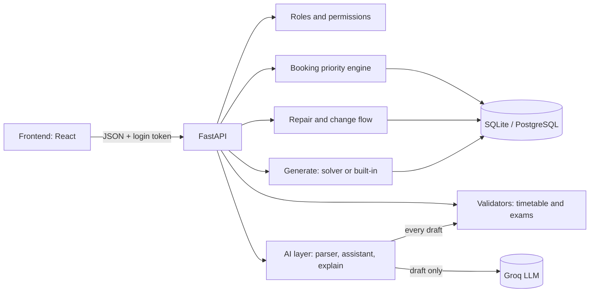

# Backend guide

## Architecture

The LLM only fills forms and rewords facts. Every decision is made by code.

## Run locally
```
cd backend
python -m venv .venv
.venv\Scripts\activate          (Mac/Linux: source .venv/bin/activate)
pip install -r requirements.txt
copy ..\.env.example .env        (then edit .env)
uvicorn app.main:app --reload
```
API pages: http://127.0.0.1:8000/docs

## Demo accounts
| Role | Email | Password |
|---|---|---|
| Admin | admin@cit.edu | Admin@123 |
| Department coordinator | coordinator@cit.edu | Coord@123 |
| Faculty | faculty@cit.edu | Faculty@123 |
| Club representative | club@cit.edu | Club@123 |

Admin has a reset button: `POST /api/admin/reset`.

## Typical flow
1. Admin: `POST /api/admin/generate` (timetable, exams, Spectra week decisions).
2. Anyone: timetables via `GET /api/timetable/view`, dashboard via `GET /api/dashboard`.
3. Club or coordinator: parse, preview, submit a booking request.
4. Faculty: chat with `POST /api/ai/assistant`. Admin approves via `POST /api/changes/{id}/approve`.
5. Admin: `POST /api/export/save?name=schedule.json`.

## Exports
`python scripts/make_exports.py` creates `exports/schedule.json` and `exports/schedule_after.json` through the app, then prints the official validator commands.

## Known limitations
- The built-in timetable generator is greedy. A solver (OR-Tools) is preferred when `backend/solver/solve.py` exists, and the better valid result is kept.
- Bookings are never placed across lunch (P5 to P6). This is a deliberate safe choice.
- Exam rooms are counted at half capacity, rounded down.
- A change request marks the faculty member unavailable at the slot they want to leave (permanent, like the sample disruption file).
- With SQLite on a free host the data resets on restart. Use PostgreSQL (`DATABASE_URL`) when deployed.
